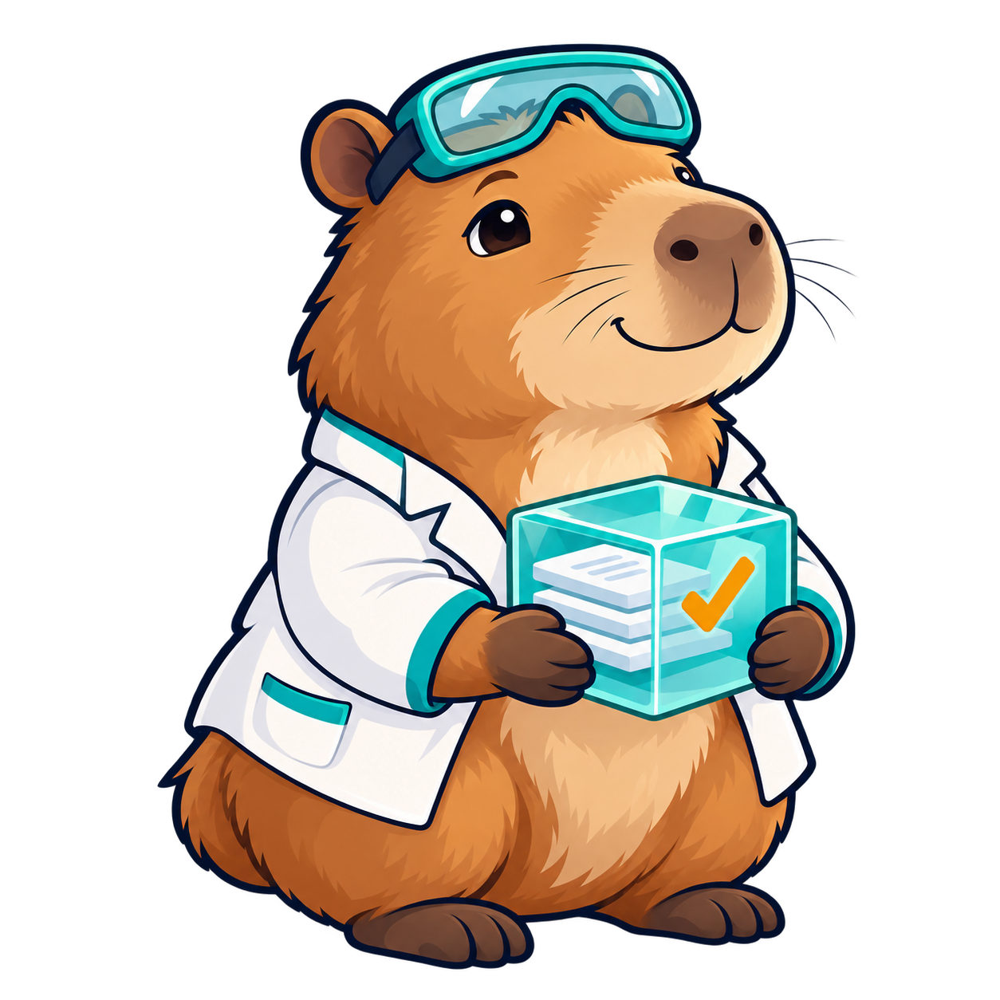

# Repro, the OpenRepro mascot

**Repro** is a friendly capybara scientist. The goggles and lab coat represent
careful experimental work. The transparent package and checkmark represent preserved,
verifiable research files. The checkmark communicates package integrity; it does
not certify scientific correctness.

The artwork was generated specifically for OpenRepro. It is original project artwork,
not GitHub's Octocat or a claim of affiliation with GitHub. The repository's MIT
license applies to this asset. Do not imply endorsements or scientific certification.

## Files and use

- [Transparent PNG mascot](assets/repro-mascot.png), 1254 × 1254 pixels, RGBA.
- [Existing vector wordmark/logo](assets/logo.svg).

Use the transparent PNG on light or dark backgrounds. Keep its aspect ratio and
clear space around the silhouette. The README renders it at 280 pixels wide without
modifying the source file. It can also be used for repository documentation, slides,
stickers and avatars. The PNG is raster artwork with a vector-like style; an editable
SVG mascot has not been produced. The original generated file is preserved separately
in the cloud workspace; this repository contains the published copy.

The character palette combines caramel/cream with teal, navy outlines and an amber
checkmark. Keep written labels such as OpenRepro outside the character illustration.
Use alt text describing the capybara and verified package when presenting it in docs.
